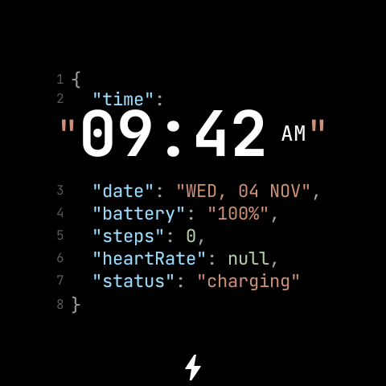
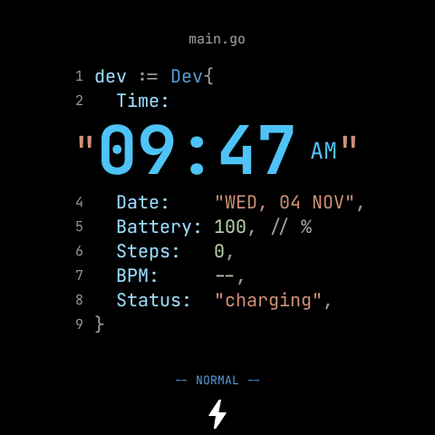
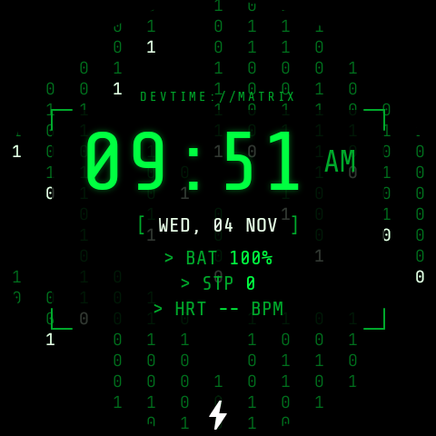

# DevTime Watch Faces

Coleção de três watch faces premium para **Wear OS** (referência: **Samsung Galaxy Watch 6**), escritas em
**Watch Face Format (WFF) v2** — pacotes declarativos, sem código executável, prontos para a Google Play.

| Produto | Application ID | Identidade |
|---|---|---|
| **JSON Developer** | `dev.devtime.watchface.json` | O dia como um arquivo JSON formatado, com syntax highlighting |
| **Code Developer** | `dev.devtime.watchface.code` | Editor de código em **Go** ou **JavaScript**, com o horário integrado ao código |
| **Matrix Developer** | `dev.devtime.watchface.matrix` | Chuva digital verde + leitura de terminal, AMOLED |

<p>



</p>

*(Capturas reais do runtime WFF no emulador Wear OS 5, 480×480.)*

## Destaques

- 19 configurações + presets (Flavors) por face — o máximo do WFF v2 — incluindo layouts, formatos de hora/data,
  estilo de cada indicador (texto, barra, anel, ícone, oculto), paletas e AOD.
- Dados reais: hora, data, bateria, passos/meta, frequência cardíaca e clima via fontes nativas do WFF v2;
  calorias e distância via complicações. Sem dado → `null` / `--` / `NO SIGNAL`, nunca um valor inventado.
- Always-On Display próprio em cada face: fundo preto, fonte light, sem segundos nem decoração.
- Matrix sem animação contínua: a chuva avança um passo por minuto via expressão.
- Validação automática contra o **XSD oficial** do WFF v2 + checagens semânticas (validador em Kotlin).

## Estrutura

```
.
├── json-developer/            módulo Android (resource-only) + generator/ (fonte do watchface.xml)
├── code-developer/            idem
├── matrix-developer/          idem
├── shared/
│   ├── design-system/         paletas, tipografia, regras visuais, licenças de fontes
│   ├── documentation/         guia para criar novas faces
│   ├── scripts/wffgen/        biblioteca Python que gera o XML WFF
│   ├── scripts/wff-validator/ validador Kotlin (XSD 1.1 oficial + regras semânticas)
│   ├── scripts/make_icons.py  ícones (indicadores, clima, launcher, loja)
│   └── wff-spec/2/            XSD oficial do WFF v2 (Apache 2.0)
├── store-assets/              ícones, screenshots, feature graphics, promocionais, textos da loja
├── scripts/                   capture.py (screenshots reais), store_assets.py, verify_package.py
├── docs/                      arquitetura, limitações WFF, configurações, testes, publicação
├── reports/                   relatório de build, validação e capturas de teste
└── build-all.sh
```

Recursos compartilhados existem só em tempo de build: cada pacote final é independente
(fontes, ícones e XML copiados/gerados dentro do próprio módulo).

## Uso rápido

```bash
./build-all.sh
```

```bash
./build-all.sh json
```

```bash
./build-all.sh validate
```

```bash
./build-all.sh screenshots matrix
```

| Comando | O que faz |
|---|---|
| `./build-all.sh` | gera XML, valida, compila APK debug + AAB release das três faces, verifica os pacotes, grava `reports/build-report.md` |
| `./build-all.sh json\|code\|matrix` | o mesmo para uma face |
| `./build-all.sh validate` | gera e valida os XMLs (XSD + semântica) sem compilar |
| `./build-all.sh screenshots [face]` | captura cenários reais num emulador/relógio conectado (`scripts/capture.py`) |
| `./build-all.sh assets` | ícones + assets da loja a partir das capturas |
| `./build-all.sh clean` | limpa builds e `dist/` |

Artefatos: `dist/<face>/<face>-<versão>-debug.apk` e `dist/<face>/<face>-<versão>-release.aab`.

## Documentação

- [Instalação do ambiente, compilação e instalação no relógio](docs/SETUP.md)
- [Arquitetura](docs/ARCHITECTURE.md)
- [Versão do WFF, limitações e alternativas](docs/WFF_LIMITATIONS.md)
- [Tabela de configurações por face](docs/CONFIGURATIONS.md)
- [Processo de testes e resultados](docs/TESTING.md)
- [Publicação na Google Play](docs/PUBLISHING.md)
- [Design system](shared/design-system/README.md)
- [Criar uma nova watch face](shared/documentation/NEW_WATCH_FACE.md)

## Licenças de terceiros

- JetBrains Mono e Share Tech Mono — SIL Open Font License 1.1 (`shared/design-system/fonts/`).
- XSD do Watch Face Format — Apache 2.0 (`shared/wff-spec/LICENSE.txt`).
